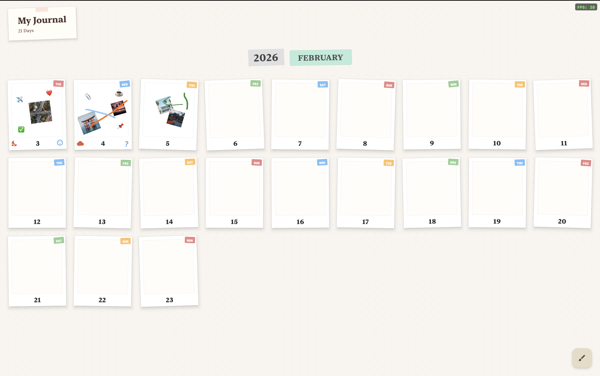
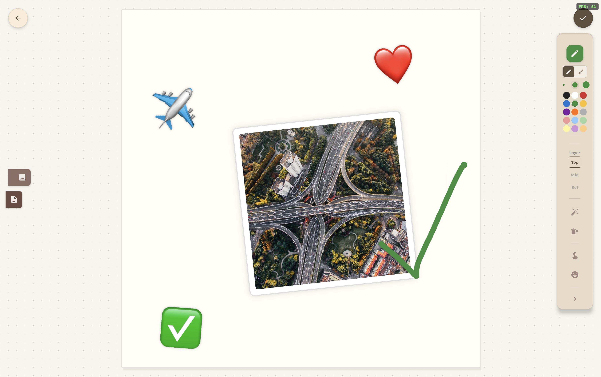
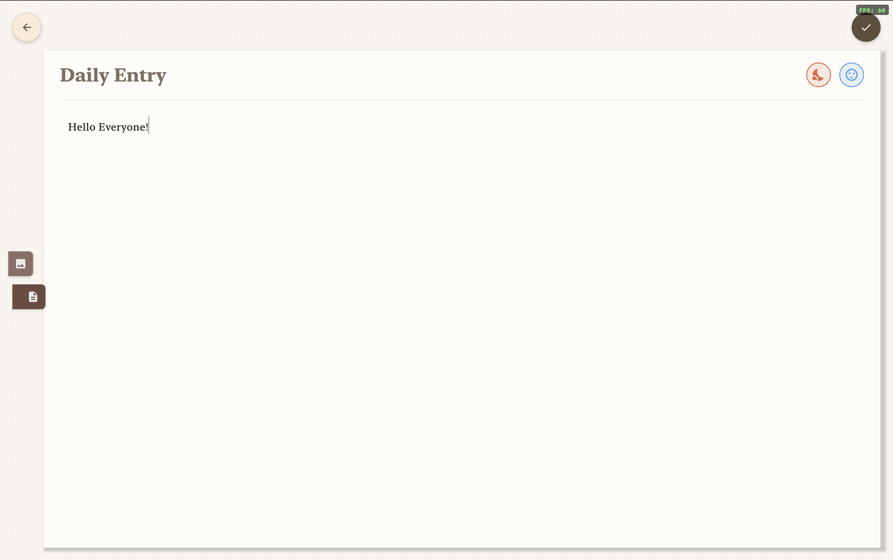
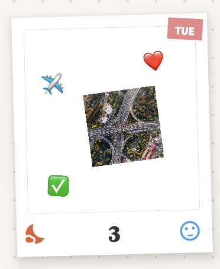
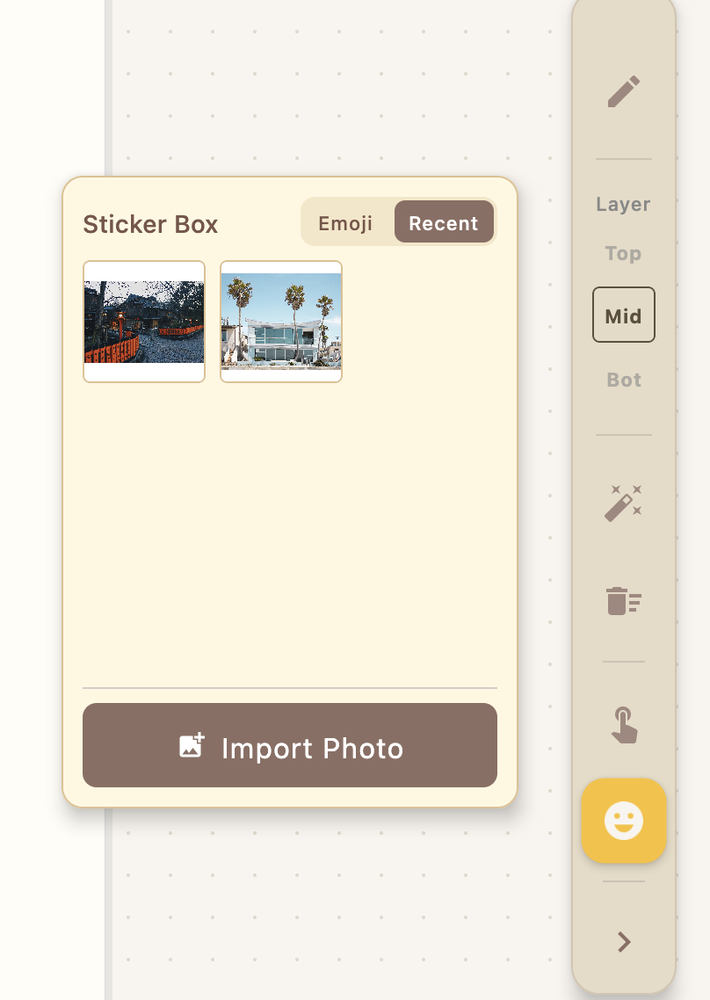

<div align="center">
  
  <br/><br/>

  <h1>📸 VisualLog</h1>
  <p><strong>The aesthetic, local-first digital scrapbook & Polaroid memory wall.</strong></p>
  <p><em>Turn your daily moments into tactile, interactive Polaroid collages — 100% offline and private.</em></p>

  <p>
    <a href="https://github.com/JohnChuhengYu/VisualLog/releases"></a>
    
    
    
    <a href="LICENSE"></a>
  </p>

  <p>
    <a href="#-quick-download">Quick Download</a> •
    <a href="#-key-features">Key Features</a> •
    <a href="#-screenshots">Screenshots</a> •
    <a href="#%EF%B8%8F-tech-highlights">Tech Highlights</a> •
    <a href="#-building-from-source">Build from Source</a>
  </p>
</div>

---

## ⚡ Quick Download

Download the ready-to-run desktop installer for your operating system from [Releases](https://github.com/JohnChuhengYu/VisualLog/releases):

| Platform | Installer Format | Architecture |
| :--- | :--- | :--- |
| 🍎 **macOS** | `.dmg` | Intel & Apple Silicon (M1/M2/M3/M4) |
| 🪟 **Windows** | `.msi` | x64 |
| 🐧 **Linux** | `.deb` | Debian / Ubuntu / Mint |

> *No JDK or terminal commands needed — just install and run natively!*

---

## 🌟 Key Features

**VisualLog** moves beyond cold, plain-text note apps. Inspired by paper bullet journals, analog cameras, and collage art, it treats every day of your life as a visual memory card.

* 📅 **Infinite Polaroid Wall**: Traverse your personal timeline seamlessly. Every single day is an authentic Polaroid card with subtle random paper tilts, washi tape labels, and live thumbnail previews.
* 🎨 **Freeform Whiteboard Canvas**: Click on any day to open a tactile canvas. Drag, resize, rotate, and layer photos, sketches, and stickers with Samsung-style gesture handles.
* 🏷️ **Washi Tape & Sticker System**: Drop in high-resolution photo stickers or native color emojis rendered via Skia color font engines (Apple Color Emoji, Segoe UI, Noto).
* ✍️ **Dual-Mode Journaling**: Switch freely between the Visual Canvas and a serif-typography Text Journal with daily Mood & Weather ink stamps.
* 📤 **One-Click Polaroid Card Export**: Export your day into a crisp, print-quality Polaroid card with authentic paper grain and stamps, automatically copied to your clipboard ready to share on Instagram, X, or Xiaohongshu!
* ⚡ **Hardware Accelerated UI**: Enforces Apple Metal & GPU acceleration via Skia for silky-smooth 60+ FPS scrolling and canvas manipulation.
* 🔒 **100% Offline & Private**: Zero accounts, zero tracking, zero cloud dependencies. All data is saved locally on your computer in an embedded SQLite database (`~/.visuallog`).

---

## 📸 Screenshots

### 1. Life Grid View (Polaroid Wall)

*A tactile overview of your days with washi tape month markers and auto-generated thumbnails.*

### 2. Daily Whiteboard Editor 

*The interactive collage canvas for drawing, stickers, and photo layering.*

### 3. Dual-Mode Text Journal & Stamps

*Preserve deep thoughts alongside your collage, stamped with weather and mood icons.*

### 4. Interactive Sticker Drawer & Photo Import
<div align="center">
  
  
</div>

---

## 🛠️ Architecture & Tech Highlights

VisualLog is crafted with modern Kotlin Multiplatform desktop architecture:

- **Language**: [Kotlin](https://kotlinlang.org/) (1.9.22)
- **UI Framework**: [Compose Multiplatform for Desktop](https://www.jetbrains.com/lp/compose-multiplatform/) (1.6.0)
- **Rendering Pipeline**: Skiko with Apple Metal / DirectX / OpenGL GPU acceleration
- **Offscreen Layer Baking**: High-resolution 2160x2160 backing bitmap buffers ensure past brush strokes render in $O(1)$ time regardless of path complexity
- **Spatial Indexing**: Custom **QuadTree** data structure for real-time stroke intersection & segment eraser hit-testing
- **Database**: [SQLite](https://sqlite.org/) paired with [JetBrains Exposed](https://github.com/JetBrains/Exposed) JDBC
- **Memory Safety**: `inSampleSize` downsampled bounds decoding prevents Out-Of-Memory exceptions on multi-megapixel photo imports

---

## 🚀 Building from Source

### Prerequisites
- [JDK 18 or higher](https://adoptium.net/)

### 1. Run in Development Mode
```bash
# Clone the repository
git clone https://github.com/JohnChuhengYu/VisualLog.git
cd VisualLog

# Run directly
./gradlew run
```

### 2. Package into Standalone Installers
```bash
./gradlew packageDistributionForCurrentOS
```
Packaged binaries will be located in:  
`build/compose/binaries/main-release/` (`.dmg` on macOS, `.msi` on Windows, `.deb` on Linux).

---

## ⚙️ Hidden Easter Egg

Need to test your timeline or jump backwards in time?
1. Focus the application window.
2. Press the `K` key rapidly **8 times**.
3. A secret debug dialog will appear allowing you to set the starting date of your journal timeline!

---

## 💬 Community & Contributing

Contributions, feedback, and feature requests are very welcome!
- Found a bug? Open an [Issue](https://github.com/JohnChuhengYu/VisualLog/issues).
- Want to contribute? Check out our [Contributing Guidelines](CONTRIBUTING.md) and submit a Pull Request.

---

<div align="center">
  <p>Crafted with ❤️ by an indie developer using Kotlin & Compose Multiplatform.</p>
  <p>If you like VisualLog, please consider giving it a ⭐️ on GitHub — it means the world to the project!</p>
</div>
